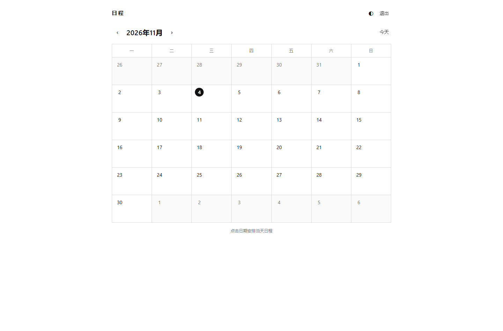
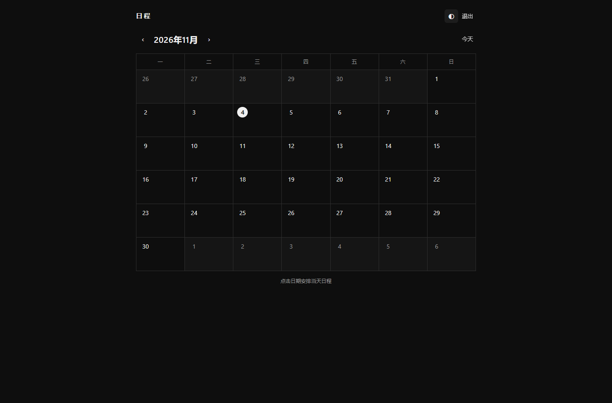
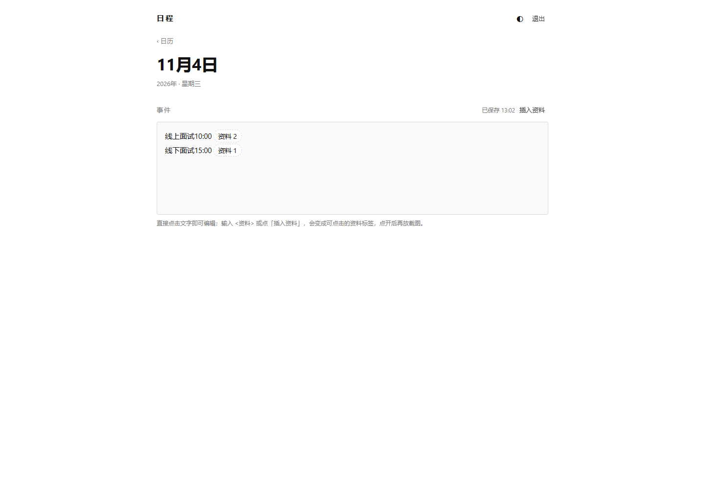
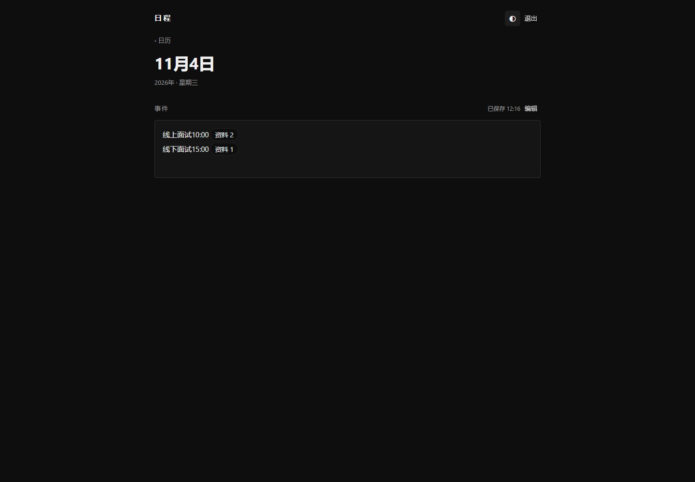
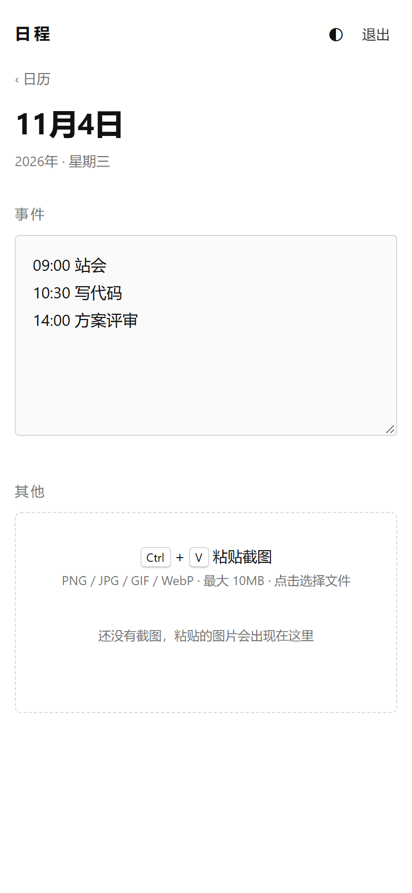

# 日程 · Schedul

> 一个极简的黑白双主题日程表：月历一览、当天事件自动保存、`Ctrl` + `V` 粘贴截图收纳。

Flask + SQLite 单文件后端，原生 HTML/CSS/JS 前端：无构建步骤、无外部服务、无前端依赖。数据全部保存在本机（SQLite 数据库 + 截图文件），适合个人自托管。

[](https://www.python.org/)
[](https://flask.palletsprojects.com/)
[](LICENSE)

## 截图

| 月历 · 浅色 | 月历 · 深色 |
| :---: | :---: |
|  |  |

| 当天 · 浅色 | 当天 · 深色 | 移动端 |
| :---: | :---: | :---: |
|  |  |  |

截图文件位于仓库的 `docs/screenshots/` 目录：

| 文件 | 内容 |
| --- | --- |
| `calendar-light.png` | 月历页 · 浅色主题 |
| `calendar-dark.png` | 月历页 · 深色主题 |
| `day.png` | 当天页（事件 + 截图）· 浅色主题 |
| `day-dark.png` | 当天页 · 深色主题 |
| `mobile.png` | 移动端布局（约 390px 宽） |

## 功能

- **月历一览**：周一开头的月视图，可切换上/下月、「今天」；有事件或截图的日期显示圆点。
- **事件自动保存**：在当天页写下内容后自动保存（停止输入 600ms 触发，失焦、切到后台、离开页面也会保存；失败自动重试），无需点按钮。
- **截图收纳**：鼠标聚焦页面后按 `Ctrl` + `V`（macOS 为 `Cmd` + `V`）直接粘贴剪贴板截图；也可点击虚线区域选择文件或拖拽上传，支持一次多张。
- **截图管理**：缩略图网格；点击查看大图（灯箱），可下载原图或删除（删除前确认，`Esc` 关闭灯箱）。
- **黑白双主题**：首次访问跟随系统深浅色，右上角 ◐ 手动切换并记住选择。
- **单账号登录**：账号密码登录，会话 Cookie `HttpOnly` + `SameSite=Lax`，有效期 30 天；同一 IP 连续失败会触发临时限流。
- **安全优先**：上传按文件头识别类型（仅 PNG / JPG / GIF / WebP，拒绝 SVG）、随机文件名、路径穿越防护、CSP 等安全响应头。
- **响应式**：桌面与移动端均可使用，无 JS 框架、无构建工具。
- **零配置存储**：首次启动自动创建 SQLite 数据库和会话密钥，无需安装数据库服务。

## 技术栈

| 层 | 选型 |
| --- | --- |
| 语言 / 运行时 | Python 3.10+ |
| Web 框架 | Flask 3.1（`Flask>=3.1,<4`） |
| 生产 WSGI 服务器 | waitress 3（`waitress>=3.0,<4`） |
| 存储 | SQLite（Python 标准库 `sqlite3`）+ 本地文件系统 |
| 前端 | 原生 HTML / CSS / JavaScript，Jinja2 模板，无构建步骤 |
| 部署 | nginx 反向代理 + systemd + Let's Encrypt（见 [deploy/DEPLOY.md](deploy/DEPLOY.md)） |

## 目录结构

```text
Schedul/
├── app.py                  # 后端单文件：页面路由、登录、事件 API、截图 API、安全头
├── wsgi.py                 # WSGI 入口：waitress-serve --listen=127.0.0.1:8000 wsgi:app
├── requirements.txt        # 运行依赖（Flask、waitress）
├── templates/              # Jinja2 模板：base / login / calendar / day / error
├── static/                 # 原生前端：style.css、theme.js、day.js、favicon.svg
├── tests/
│   └── test_app.py         # 核心功能测试（unittest，使用临时目录，不碰真实数据）
├── deploy/
│   ├── DEPLOY.md           # Ubuntu + nginx + systemd + HTTPS 部署指南
│   ├── schedul.service     # systemd 服务模板
│   └── nginx-schedul.conf  # nginx 站点配置模板
├── docs/screenshots/       # README 使用的截图
├── data/                   # 运行时数据（已 gitignore）：app.db、uploads/、secret_key
├── .env.example            # 环境变量清单（示例，不含真实密码）
├── .gitignore
├── LICENSE                 # MIT
└── README.md
```

## 快速开始

**环境要求：** Python 3.10 及以上、pip。不需要 Node.js、数据库服务或 Docker。

应用通过**环境变量**读取配置（不会自动读取 `.env` 文件，详见[环境变量](#环境变量)），下面直接在当前终端设置。默认账号 `admin` / `admin123` **仅供本机体验，请立刻改成自己的强密码**。

### Windows（PowerShell）

```powershell
python -m venv .venv
.\.venv\Scripts\Activate.ps1
python -m pip install --upgrade pip
python -m pip install -r requirements.txt

$env:APP_USERNAME = "your-name"
$env:APP_PASSWORD = "a-long-random-password"
python app.py
```

> 若 PowerShell 禁止运行激活脚本，可跳过激活，直接使用 `.\.venv\Scripts\python.exe -m pip install -r requirements.txt` 与 `.\.venv\Scripts\python.exe app.py`。

### Linux / macOS

```bash
python3 -m venv .venv
source .venv/bin/activate
python -m pip install --upgrade pip
python -m pip install -r requirements.txt

export APP_USERNAME="your-name"
export APP_PASSWORD='a-long-random-password'
python app.py
```

浏览器打开 <http://127.0.0.1:8000>，会跳转到登录页；输入上面设置的账号密码进入月历。

- 端口被占用时：`PORT=8080 python app.py`（Windows PowerShell：`$env:PORT = "8080"; python app.py`）。
- 需要局域网访问时：`HOST=0.0.0.0 python app.py`，同时务必设置强密码；公网部署必须使用 HTTPS（见 [deploy/DEPLOY.md](deploy/DEPLOY.md)）。
- 生产环境请用 waitress 而不是 Flask 自带服务器：

```bash
waitress-serve --listen=127.0.0.1:8000 wsgi:app
```

## 数据存储与备份

默认数据目录是项目根目录下的 `data/`（可用 `DATA_DIR` 改为其他路径，生产部署建议放到独立目录，见部署文档）：

| 路径 | 内容 |
| --- | --- |
| `data/app.db` | SQLite 数据库：`days` 表保存每天的事件文本，`images` 表保存截图元数据 |
| `data/uploads/<YYYY-MM-DD>/<随机文件名>.<png\|jpg\|gif\|webp>` | 截图原文件，按日期分目录 |
| `data/secret_key` | 未设置 `SECRET_KEY` 时首次启动自动生成的会话签名密钥（权限 0600），用于签名登录 Cookie |

`data/` 与 `.env` 已在 `.gitignore` 中忽略，请勿把真实数据提交到仓库。截图内容可能包含隐私信息，备份文件也要妥善保管。

**备份（运行中也可安全执行）：**

```bash
# 1) 用 SQLite 在线备份命令得到一致的数据库副本
sqlite3 data/app.db ".backup 'app-backup.db'"

# 2) 打包截图目录
tar -czf uploads-backup.tar.gz -C data uploads
```

Windows 可用 `sqlite3.exe` 执行同样的 `.backup`，再对 `data\uploads` 打包；或者先停止应用，直接复制整个 `data/` 目录。

**恢复 / 迁移：**

1. 停止应用；
2. 将备份的 `app.db`、`uploads/`（以及需要保留登录状态时的 `secret_key`）放回数据目录；
3. 确保运行用户对数据目录有读写权限；
4. 启动应用。

## 环境变量

配置项与 [.env.example](.env.example) 保持一致：

| 变量 | 默认值 | 说明 |
| --- | --- | --- |
| `APP_USERNAME` | `admin` | 登录用户名，**生产环境必须修改** |
| `APP_PASSWORD` | `admin123` | 登录密码，**生产环境必须修改为强密码** |
| `SECRET_KEY` | 空 | 会话签名密钥。留空时首次启动自动生成到 `data/secret_key`；设置后优先使用该值，更换它会让所有已登录会话失效 |
| `DATA_DIR` | 空 | 数据目录。留空表示项目根目录下的 `data/`；生产环境建议指定独立路径（如 `/var/lib/schedul`） |
| `APP_TZ` | `Asia/Shanghai` | 时区，决定「今天」以及页面上事件/截图时间的显示 |
| `COOKIE_SECURE` | `0` | 设为 `1` 时会话 Cookie 仅通过 HTTPS 传输。**HTTPS 部署必须设为 1**；纯 HTTP 调试时保持 0，否则登录后 Cookie 不会发送、表现为登录无效 |
| `HOST` | `127.0.0.1` | 仅 `python app.py` 开发服务器使用：监听地址。容器内可设为 `0.0.0.0` |
| `PORT` | `8000` | 仅 `python app.py` 开发服务器使用：监听端口。waitress 的监听地址由 `--listen` 参数决定 |

说明：

- 应用**不会自动加载 `.env` 文件**（未引入 `python-dotenv`）。`.env.example` 只是变量清单参考：开发时手动 `export` / `$env:` 注入；生产时由 systemd 的 `EnvironmentFile=` 注入（见部署模板）。
- `DEBUG=1` 会以调试模式启动 `python app.py`（代码中读取，未列入 `.env.example`）。**只在本机开发时使用，切勿在生产环境开启**。
- 时间戳在数据库中以 UTC 保存，页面按 `APP_TZ` 转换显示；改时区只需修改环境变量并重启。

## 路由与 HTTP API

页面路由（除登录页外均需登录；未登录访问页面会跳转到 `/login`，访问 `/api/`、`/uploads/` 返回 `401`）：

| 方法 | 路径 | 说明 |
| --- | --- | --- |
| `GET` | `/` | 月历。可选查询参数 `?month=YYYY-MM` 查看指定月份 |
| `GET` | `/day/<YYYY-MM-DD>` | 当天页：事件文本框 + 截图区；非法日期返回 404 |
| `GET` | `/login` | 登录页（已登录则跳回月历） |
| `POST` | `/login` | 表单登录，字段 `username`、`password`、可选 `next`；失败 401，限流 429 |
| `POST` | `/logout` | 退出登录（仅 POST，需登录），清空会话后跳回登录页 |

JSON / 文件 API：

| 方法 | 路径 | 请求 | 成功响应 |
| --- | --- | --- | --- |
| `GET` | `/api/days/<YYYY-MM-DD>` | — | `200` `{date, event, updated_at, images[]}`；日期非法 404 |
| `PUT` | `/api/days/<YYYY-MM-DD>` | JSON：`{"event": "文本"}`，最长 20000 字 | `200` `{ok: true, updated_at, time_label}`；格式/类型/超长 400，日期非法 404 |
| `POST` | `/api/days/<YYYY-MM-DD>/images` | 原始图片字节（请求体即文件），`Content-Type` 为 `image/png`、`image/jpeg`、`image/gif` 或 `image/webp` | `201` `{"image": {id, url, download_url, mime, size, size_label, created_at, time_label}}`；空请求 400、超 10MB 413、非位图 415 |
| `DELETE` | `/api/images/<id>` | — | `200` `{ok: true}`；不存在 404 |
| `GET` | `/uploads/<YYYY-MM-DD>/<文件名>` | 可选 `?download=1` 以附件形式下载 | 返回图片；文件名/日期不合法或不存在 404 |

接口示例（需要先登录拿到会话 Cookie）：

```bash
# 登录并保存 Cookie
curl -c cookies.txt -X POST \
  -d "username=your-name&password=a-long-random-password" \
  http://127.0.0.1:8000/login

# 保存某天事件
curl -b cookies.txt -X PUT -H "Content-Type: application/json" \
  -d '{"event":"09:00 站会\n14:00 评审"}' \
  http://127.0.0.1:8000/api/days/2026-11-04

# 上传一张截图（请求体为原始 PNG 字节）
curl -b cookies.txt --data-binary @shot.png \
  -H "Content-Type: image/png" \
  http://127.0.0.1:8000/api/days/2026-11-04/images

# 删除截图（id 来自上一步响应）
curl -b cookies.txt -X DELETE http://127.0.0.1:8000/api/images/1
```

> 上传接口不信任客户端声明的 `Content-Type`：服务端按文件头魔数识别格式，只接受 PNG / JPEG / GIF / WebP 位图，SVG 和伪装成图片的文本会被拒绝（415）。

## 测试

```bash
python -m unittest discover -s tests -v
```

当前共 24 个用例，全部通过。测试覆盖登录/登出、登录限流、开放重定向拦截、月历与当天页、事件保存/清空/校验/XSS 转义、截图上传/查看/下载/删除、伪造与截断图片拒绝、路径穿越、安全响应头等；每个用例使用临时数据目录，不会读写 `data/` 中的真实数据。

## 安全说明

本项目是**单用户**的个人工具，按公网服务标准也做了基础加固，但请务必注意：

- **必须修改默认密码**：`admin` / `admin123` 只用于本机首次体验；部署到局域网或公网前，通过 `APP_USERNAME` / `APP_PASSWORD` 设置强密码，并妥善保管 `/etc/schedul.env`（权限 600）。
- **公网必须使用 HTTPS**：前置 nginx + Let's Encrypt，并把 `COOKIE_SECURE` 设为 `1`，否则登录 Cookie 与截图内容可能明文传输。
- **会话**：Flask 签名 Cookie，`HttpOnly`、`SameSite=Lax`，有效期 30 天；更换 `SECRET_KEY` 可让所有已登录会话立即失效。退出登录使用 POST 表单。
- **登录限流**：同一 IP 在 10 分钟内失败 10 次后暂时拒绝登录；限流计数保存在进程内存中，重启后清空。反代部署时所有请求的 `remote_addr` 都是 `127.0.0.1`，即限流按整个站点统一计数（单用户场景影响不大；若将来改成多用户需自行处理真实 IP）。
- **上传限制**：单张截图最大 10MB，只接受 PNG / JPG / GIF / WebP 位图（校验文件头魔数，拒绝 SVG 以防 XSS）；文件以随机文件名保存并按日期分目录，路径参数经过白名单校验；截图访问、下载均需登录。
- **CSRF**：事件保存使用 JSON `PUT`，截图为原始请求体上传，跨站表单无法直接伪造；会话 Cookie 使用 `SameSite=Lax`，进一步降低跨站请求风险。登录/登出为同源表单提交。若需更高强度，可在前置 nginx 增加额外校验。
- **安全响应头**：CSP（禁止内联脚本与第三方资源）、`X-Content-Type-Options: nosniff`、`X-Frame-Options: DENY`、`Referrer-Policy: same-origin`。
- **建议**：不要把数据库/截图目录暴露为静态目录；`data/` 内含隐私内容，定期备份并限制文件权限；如仅个人使用，可只允许自己的 IP 或通过 VPN 访问。

## 部署到 Linux

生产环境推荐：**Ubuntu 22.04 / 24.04 + nginx + waitress + systemd + Let's Encrypt HTTPS**。

```bash
# 详见分步指南：deploy/DEPLOY.md
# 模板：
#   deploy/schedul.service     systemd 服务
#   deploy/nginx-schedul.conf  nginx 站点配置
```

完整步骤（创建用户与目录、上传代码、venv、环境变量文件、systemd、nginx、certbot、防火墙、升级与回滚、备份与恢复、日志排查）见 **[deploy/DEPLOY.md](deploy/DEPLOY.md)**，其中的域名统一使用占位符 `example.com`，请替换为你自己的域名。也支持挂载到已有域名的子路径（如 `https://example.com/schedul/`），见部署文档的「挂载到子路径」一节。

## 常见问题

**端口被占用（`Address already in use`）**
换端口启动：`PORT=8080 python app.py`。查看占用进程：Linux `ss -ltnp | grep 8000`；Windows `Get-NetTCPConnection -LocalPort 8000`。

**页面上的日期/时间不对**
设置 `APP_TZ`（如 `Asia/Shanghai`、`Europe/Berlin`）后重启。数据库里存的是 UTC，页面按 `APP_TZ` 显示；月历的「今天」也使用该时区。

**怎么迁移到另一台机器**
停止应用 → 复制整个数据目录（默认 `data/`，生产为 `DATA_DIR` 指向的目录，如 `/var/lib/schedul`）到新机器 → 设置相同的 `APP_TZ`（建议同时保留 `secret_key` 或 `SECRET_KEY`）→ 启动。只迁移数据库而丢失 `uploads/` 会导致缩略图 404。

**忘记密码**
修改 `APP_PASSWORD`（或 systemd 环境变量文件中的值）并重启服务即可。已登录的浏览器会话在 30 天有效期内仍然有效；要强制全部下线，请同时更换 `SECRET_KEY` 并重启。

**点「登录」后仍停留在登录页 / 登录无效**
如果通过 HTTPS 部署却设置了 `COOKIE_SECURE=1`，请确认浏览器地址是 `https://`；如果还在用 HTTP 调试，把 `COOKIE_SECURE` 改回 `0` 并重启。反向代理时 Cookie 不会跨协议发送。

**`Ctrl` + `V` 粘贴没有反应**
需要先点一下页面让窗口获得焦点；剪贴板中必须包含图片文件（部分截图工具只放文本）。也可以点击「其他」区域的虚线框选择文件，或把图片直接拖进该区域。macOS 使用 `Cmd` + `V`。

**nginx 返回 413（上传太大）**
nginx 默认请求体限制很小。确认站点配置中有 `client_max_body_size 12m;`（略大于应用的 10MB 限制），然后 `sudo nginx -t && sudo systemctl reload nginx`。

**README 截图显示不出来**
确认 `docs/screenshots/` 下的 5 个 PNG 已提交到仓库，文件名大小写与 README 引用一致。

## 参与贡献

欢迎提交 Issue 和 Pull Request。改动请保持项目定位（极简、无前端构建、单用户），并确保 `python -m unittest discover -s tests -v` 全部通过；涉及前端的改动请附上浅色/深色与移动端截图。

## License

[MIT](LICENSE) © 2026 Schedul contributors
